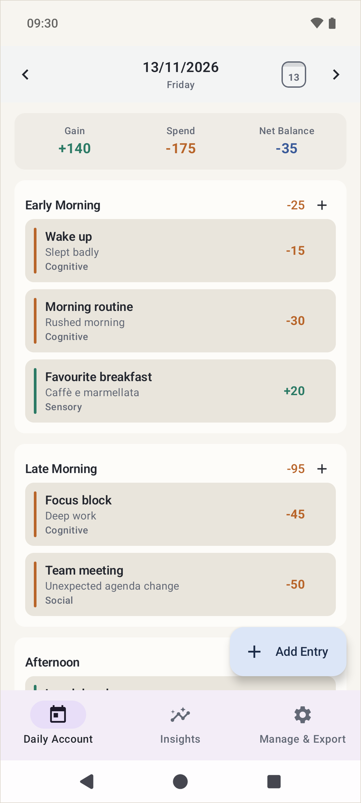

<p align="center">
  
</p>

<h1 align="center">Energy Accounting</h1>

<p align="center">A private, offline-first Android ledger for the Energy Accounting method.</p>

<p align="center">
  <a href="https://github.com/iseppe/energy-accounting/releases/latest"></a>
  <a href="LICENSE"></a>
  <a href="#install"></a>
</p>

<p align="center">
  
  
  
</p>

## What it is

Energy Accounting is a personal stress-management and energy-monitoring
app based on the Energy Accounting method by **Maja Toudal and Tony Attwood**.
It helps you track how daily activities drain or recharge energy across distinct
areas of functioning, using a zero-based daily ledger: every day starts at zero
and each entry is either a **Gain (+)** deposit or a **Spend (−)** withdrawal.

**Not medical advice.** The app is a self-tracking tool, not a medical device or
a substitute for professional care.

## Features

- **Daily Account** — a zero-based energy ledger per day with Total Gain, Total
  Spend, and Net Balance, split into four Time Slots (Early Morning, Late
  Morning, Afternoon, Evening).
- **Entries** — log an Activity with an optional Situational Note, a Direction
  (Spend/Gain), an Energy Value from 1 to 100, and one Energy Dimension
  (Physical, Cognitive, Sensory, Social, Emotional, plus custom dimensions).
- **Activity Templates** — reusable blueprints that pre-fill direction, value,
  and dimension; pin your favourites for one-tap logging.
- **Check-in Reminders** — purely local notifications per Time Slot that
  automatically stay quiet when the slot already has entries.
- **Insights** — summary grid, Gain/Spend/Net trend chart, and breakdowns by
  dimension and time slot for today, the last 7 or 30 days, or a custom range.
- **Calendar history** — browse past days at a glance.
- **Export** — share a practitioner PDF report, export a CSV ledger, and back
  up or restore JSON.
- **Light and dark themes** — follow the system or choose light or dark.
- **Configurable haptics** — tap feedback can be turned off in settings.
- **In-app updates** — checks GitHub Releases on launch and when you return to
  the app, at most once a day. A floating prompt offers **Later** or **Update**;
  the APK downloads inside the app, is verified before install, and then opens
  Android's system installer. The Updates card in Manage & Export has the
  automatic-check switch and **Check now**.
- **Two languages** — English and Italian.

## Install

1. Download the APK from the
   [latest release](https://github.com/iseppe/energy-accounting/releases/latest).
2. On your phone, allow installs from unknown sources (Android asks per app when
   you open the APK).
3. Open the APK and install. Requires **Android 8.0 or newer**.

v0.4.0 introduced in-app updates. Install v0.4.1 once by hand; while this
repository is private, the in-app updater cannot see new releases. Once the
releases are public, the app can check for updates on launch and install them
after verifying the SHA-256, package name, and signer. The first in-app update
may ask you to allow installs from Energy Accounting.

If you are migrating from the debug build to the release build: export a JSON
backup from the debug build, uninstall the debug build, install the release
build, and restore the JSON backup.

### In-app updates

The app reads releases from
[GitHub Releases](https://github.com/iseppe/energy-accounting/releases). When a
newer version is available, a prompt shows its version and notes; **Later**
hides that version for 24 hours, and **Update** downloads and verifies it before
handing it to Android's installer. The download is checked against the published
SHA-256, the expected package name, and the certificate of the installed app, so
a failed check stops the update instead of opening the installer.

Automatic checks run at most once a day, and you can turn them off in
**Manage & Export → Updates**; **Check now** there still works with automatic
checks off.

## Privacy

- No account, no ads, no analytics, no trackers.
- All entries stay in a local Room database on your device.
- The in-app update check is on by default. Turn it off in
  **Manage & Export → Updates**; **Check now** remains available there.
- The only network access is the update check and the APK download. Nothing is
  uploaded.

## Build from source

Requirements: **JDK 17+** and the **Android SDK 35**.

```bash
./gradlew assembleDebug        # build
./gradlew testDebugUnitTest    # test
```

Translations live in `app/translations.json`; edit that file rather than the
generated XML.

## License

Copyright (C) 2026 iseppe. Licensed under GPL-3.0-only. Full text in [LICENSE](LICENSE).

Credits: the launcher icon uses Lucide brain/zap glyphs
([ISC license](docs/licenses/lucide.txt)).
